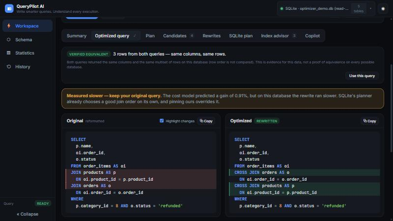
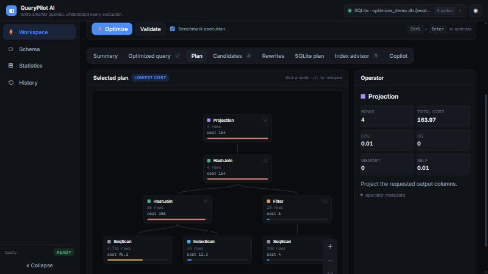
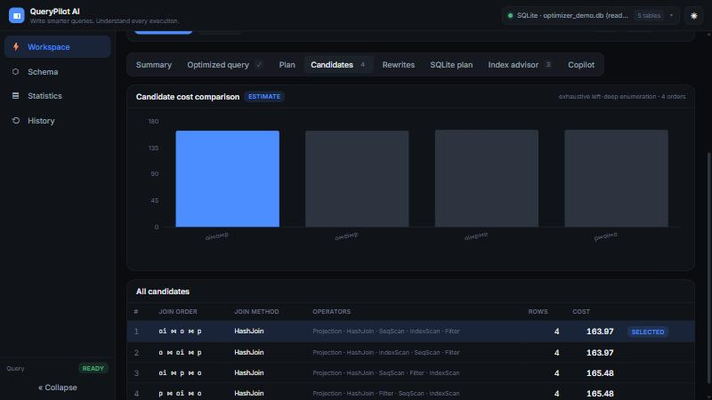

# QueryPilot AI

**Write smarter queries. Understand every execution.**

A SQL query optimizer and performance workbench for any SQLite database. Paste a query
and it shows how a cost-based optimizer would execute it, compares the alternatives,
suggests a reordered query when the cost model finds one, **checks that the rewrite returns
the same rows, measures both, and tells you honestly whether it helped.**


> **It is not tied to one database.** Nothing in the optimizer knows a table or column name.
> Point it at any SQLite file (or switch files from the top bar) and the schema, statistics,
> example queries and plans all come from that database. Tests run the whole pipeline on two
> unrelated schemas and on a database with awkward identifiers (`"Order Details"`).

## What it does

For a read-only `SELECT`, the backend:

1. **Discovers the schema** (tables, columns, keys, indexes, foreign keys).
2. **Computes statistics** from the live data (row counts, distinct values, nulls, min/max,
   most-common values).
3. **Parses** the SQL with `sqlglot` into a relational-algebra tree.
4. **Estimates** selectivity and cardinality, then **costs** candidate physical plans with an
   explicit, documented cost model ([COST_MODEL.md](COST_MODEL.md)).
5. **Picks the cheapest plan** and explains why it won.
6. **Suggests a reordered query** (join order only) and **verifies** it returns the same rows.
7. **Benchmarks** the original and the rewrite and reports *faster / slower / no measurable
   difference* — never a speedup the measurements don't support.
8. **Compares with SQLite's own `EXPLAIN QUERY PLAN`**, advises on hypothetical indexes, and
   explains the result with an optional AI copilot (works offline without a key).

## Being honest about results

The cost model is an educational estimator, not a copy of SQLite's planner, and SQLite's
planner is good. In testing, join orders that the model preferred were **sometimes slower**
when forced on SQLite. The UI therefore leads with the measurement:



- **Estimated** (cost model) and **Measured** (wall-clock) are always labelled and never mixed.
- A rewrite is shown only if the database confirms it returns the same columns and rows
  *on this data* (evidence, not a proof for every database).
- "Faster" or "slower" is only claimed when the measured ranges don't overlap.
- If the query is already optimal, it says so.
- The estimated gain is measured against **your query as written**, not a strawman.

## Screenshots

**Execution plan** — cost-heat bars mark expensive operators; click a node for details.



**Candidate plans** — every enumerated join order, costed and ranked.



**Schema** — discovered dynamically from whichever database is connected.


## Quick start

```bash
# Backend
cd backend
python -m venv .venv && . .venv/Scripts/activate   # macOS/Linux: source .venv/bin/activate
pip install -r requirements.txt
cp .env.example .env
python -m seed.generate                 # optional: create the demo database
uvicorn app.main:app --reload --port 8000

# Frontend (second terminal)
cd frontend
npm install
npm run dev                             # http://localhost:5173
```

Open the dashboard and press **Optimize** — the editor starts with an example generated
from your database's own schema. Use the database chip in the top bar to open any other
SQLite file. Details: [SETUP.md](SETUP.md).

## Configuration

Set in `backend/.env` (see `.env.example`). Highlights:

| Variable | Default | Meaning |
|---|---|---|
| `DATABASE_PATH` | `optimizer_demo.db` | SQLite file connected at startup |
| `ALLOW_INDEX_CREATION` | `false` | Databases are opened **read-only** unless this is `true` |
| `OPENAI_API_KEY` | _(empty)_ | Optional; the copilot works offline without it |
| `MIN_ESTIMATED_GAIN_PCT` | `0.5` | A rewrite must beat your query by at least this estimate |
| cost-model constants | see `.env.example` | I/O, CPU, rows-per-page and fallback selectivities |

## Tests

```bash
cd backend && pytest -q
```

Covers parsing, safety, schema discovery, statistics, selectivity, cardinality, cost, join
ordering, plans, rewriting and equivalence checking, the HTTP API, database switching, the
read-only guarantee, concurrency, determinism across hash seeds, and a database with
awkward identifiers — on more than one schema.

## Documentation

| Doc | Contents |
|---|---|
| [SETUP.md](SETUP.md) | Install and run |
| [ARCHITECTURE.md](ARCHITECTURE.md) | Modules and data flow |
| [OPTIMIZER.md](OPTIMIZER.md) | Parsing, plans, rewrite and verification |
| [COST_MODEL.md](COST_MODEL.md) | Every cost formula |
| [STATISTICS.md](STATISTICS.md) | How statistics and selectivity work |
| [DATABASES.md](DATABASES.md) | Database support and the adapter layer |
| [API.md](API.md) | HTTP endpoints |
| [DEMO.md](DEMO.md) | Demo data and sample queries |
| [LIMITATIONS.md](LIMITATIONS.md) | What it does not do |

## License

MIT — see [LICENSE](LICENSE).
