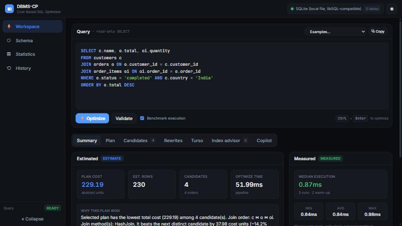
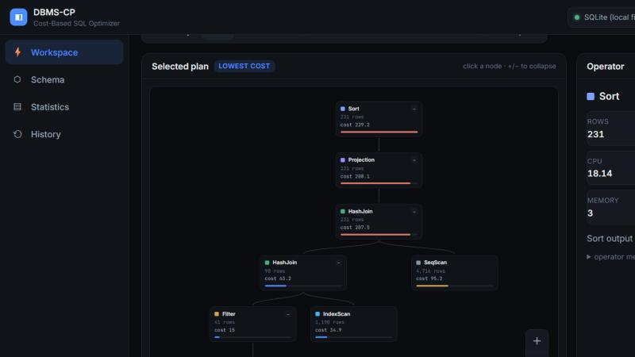
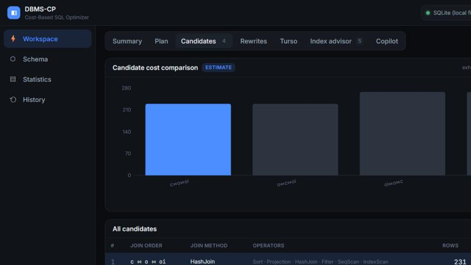
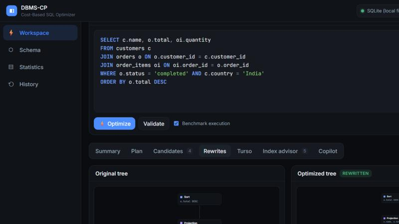
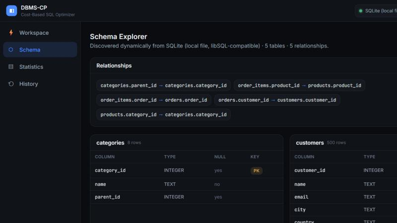

# AI-Powered Cost-Based SQL Query Optimizer & Database Performance Analyzer

A web-based, **cost-based SQL query optimizer** and performance analyzer built on
**Turso / libSQL** (SQLite-compatible). It parses SQL with `sqlglot`, discovers the
live database schema dynamically, computes real statistics, estimates selectivity
and cardinality, enumerates candidate physical plans, costs them with an explicit
educational cost model, selects the cheapest, applies logical optimizations,
compares against SQLite/libSQL `EXPLAIN QUERY PLAN`, benchmarks real execution
time, advises on hypothetical indexes, and explains everything through an AI
copilot — all surfaced in a professional React dashboard.



> **The optimizer is schema-agnostic.** The 5-table e-commerce database is only a
> demonstration dataset. Point it at any SQLite/libSQL/Turso database and it keeps
> working. A test suite proves this by running the whole pipeline against a second,
> unrelated "library" schema and by statically auditing the optimizer source for
> hardcoded table names.

## What it does (the data flow)

```
Turso/libSQL → Schema Discovery → Statistics → SQL Parser → Relational Algebra
→ Selectivity → Cardinality → Candidate Physical Plans → Cost Model → Best Plan
→ Logical Optimizations → Turso EXPLAIN QUERY PLAN → Application Benchmark
→ Index Advisor → AI Explanation → React Dashboard
```

## Screenshots

**Execution plan** — the lowest-cost physical plan as an interactive tree. Each node
shows estimated rows and cost; the bar under each node is a cost-heat indicator
(expensive operators glow red), and clicking a node opens the operator inspector.



**Candidate plans** — every enumerated join order/method, costed and ranked; the
selected (lowest-cost) plan is highlighted.



**Logical rewrites** — the original relational-algebra tree vs. the optimized tree
(predicate pushdown, projection pushdown, join reordering), with quantified cost deltas.



**Schema Explorer** — the connected database, discovered dynamically: tables, columns,
keys, indexes and foreign-key relationships.



> The UI clearly separates **estimated** cost-model values from **measured** benchmark
> timings, and never presents an estimate as a measured speedup. Dark and light themes
> are both supported.

## Feature highlights

- **Dynamic schema discovery** via `sqlite_master` + `PRAGMA table_info / index_list /
  index_info / foreign_key_list`.
- **Statistics engine** that computes row counts, distinct counts, null fractions,
  min/max and most-common-value histograms with real SQL aggregates.
- **Selectivity engine** (equality, inequality, ranges, `BETWEEN`, `IN`, `IS [NOT] NULL`,
  `AND`, `OR`) that reports its method and assumptions — no magic numbers.
- **Cardinality estimation** including the System-R equi-join formula.
- **Explicit cost model** (sequential/index scan; nested-loop, index-nested-loop, hash,
  merge joins; filter, projection, sort, aggregate) — documented in
  [COST_MODEL.md](COST_MODEL.md).
- **Physical plan enumeration** with join-order search (exhaustive for small queries,
  System-R dynamic programming for larger ones).
- **Logical optimizations**: predicate pushdown, projection pushdown, join reordering,
  each with before/after trees and quantified cost improvement.
- **Turso/SQLite `EXPLAIN QUERY PLAN` comparison** (plus optional `EXPLAIN` bytecode).
- **Application-level benchmarking** (warm-up + measured runs; min/max/avg/median) kept
  strictly separate from estimated cost.
- **What-if index advisor** that simulates a hypothetical index and re-costs the plan,
  never creating an index unless you explicitly ask.
- **AI Copilot** grounded strictly in the optimizer's structured output, with a full
  offline deterministic fallback.
- **Read-only safety** enforced on the `sqlglot` AST.

## Quick start

See [SETUP.md](SETUP.md) for full details.

```bash
# 1) Backend
cd backend
python -m venv .venv && . .venv/Scripts/activate   # Windows: .venv\Scripts\activate
pip install -r requirements.txt
cp .env.example .env
python -m seed.generate                 # generate the demo database
uvicorn app.main:app --reload --port 8000

# 2) Frontend (in another terminal)
cd frontend
npm install
npm run dev                             # http://localhost:5173
```

Then open the dashboard, go to **SQL Optimizer**, and click **Optimize**.

## Documentation

| Doc | Contents |
|-----|----------|
| [SETUP.md](SETUP.md) | Install & run (local file or remote Turso) |
| [ARCHITECTURE.md](ARCHITECTURE.md) | Modules, layering, data flow |
| [OPTIMIZER.md](OPTIMIZER.md) | Parsing → RA → plans → selection |
| [COST_MODEL.md](COST_MODEL.md) | Every cost formula |
| [STATISTICS.md](STATISTICS.md) | How stats & selectivity are computed |
| [TURSO.md](TURSO.md) | Why Turso/libSQL, how the adapter works |
| [API.md](API.md) | Every HTTP endpoint |
| [DEMO.md](DEMO.md) | Demo dataset & sample queries |
| [LIMITATIONS.md](LIMITATIONS.md) | Limits vs PostgreSQL + future scope |

## Tests

```bash
cd backend && pytest -q
```

48 tests cover parsing, safety, schema discovery, statistics, selectivity,
cardinality, cost, join ordering, physical plans, transformations, index advisor,
EXPLAIN parsing, and benchmarking — run against **both** the e-commerce and the
unrelated library schema.
